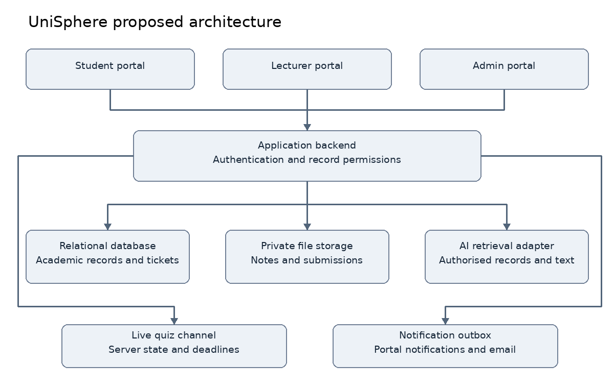
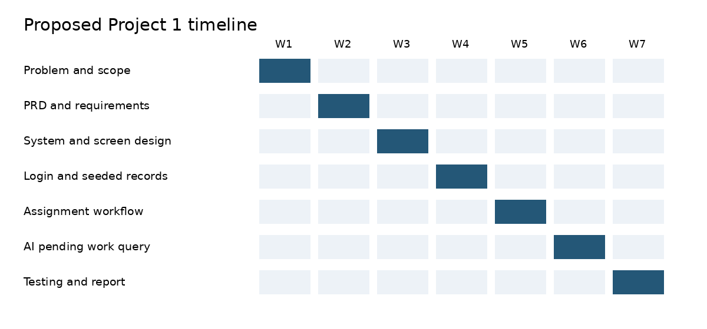

# UniSphere
### An Integrated University Academic Portal with an AI Assistant

Final Year Project by **Shri Vignarohan A/L S. Ramasamy**  
Bachelor of IT Honours Cyber Security

UniSphere brings academic management, learning resources and student support into one organised web portal.

## Project status
**Django and PWA foundation implemented on the `feature/django-pwa-foundation` branch. The full application remains in development.**
Student ID, university details, supervisor and the actual course schedule remain to be confirmed.

## Run the first working version

See the [Windows and macOS/Linux setup guide](docs/DEVELOPMENT.md). It includes the demo account setup, PostgreSQL option, assignment demonstration and test commands.

This milestone implements role sign-in, three dashboards, enrolled subjects, protected notes, assignment publication and versioned submission, released feedback, attendance display, a class timetable, historical CGPA, sample fee balances and PWA installation support. The floating helper currently performs authorised record lookups; model-powered AI, quizzes, tickets and email are still planned.

## The problem
Students need a clear way to find deadlines, submit work, track attendance and results, recover missed lessons and resolve administrative enquiries. Lecturers need a class overview that highlights outstanding work and students who may need support.

## Three connected portals
| Student | Lecturer | Admin |
| --- | --- | --- |
| Subjects, notes and recordings | Upload and publish materials | Users, roles and enrolments |
| Assignments and feedback | Assignments, marking and feedback | Academic structures and policies |
| Attendance, timetable and exams | Attendance and class schedule | Timetables and examination records |
| Results, GPA and CGPA | Student progress and attention filters | Published results and sample fees |
| Quiz Me and live quiz participation | Quiz Your Students and session results | Ticket oversight and system activity |
| Simulated finance and support tickets | Support tickets and announcements | Overall platform management |

## Built in AI assistant
A floating robot button opens a contextual chat panel. Planned examples:
- “What assignments do I still need to submit?”
- “I missed Monday's class. Show me the notes and recording.”
- “Explain this topic and quiz me.”
- Lecturer: “Who has outstanding submissions in my class?”

The assistant retrieves authorised records and explains supplied learning materials with references. Missing information is disclosed. Catch-up completion does not change historical attendance.

## Quizzes and support
**Quiz Me** provides individual practice. **Quiz Your Students** lets lecturers launch interactive timed quizzes and notify their class to join through an authenticated link or code.

All roles can submit category-based tickets to eligible recipients. Receivers get portal notifications and email links. Replies, status changes and resolution history stay inside the portal.

## Documentation
| Document | Open |
| --- | --- |
| Full product requirements and acceptance criteria | [PRD](PRD.md) |
| Project proposal | [PDF](docs/UniSphere_Project_Proposal.pdf) · [Word](docs/UniSphere_Project_Proposal.docx) · [Markdown](docs/UniSphere_Project_Proposal.md) |
| Product requirements document | [PDF](docs/UniSphere_PRD.pdf) · [Word](docs/UniSphere_PRD.docx) |
| Simple project explanation | [Overview](docs/SIMPLE_OVERVIEW.md) |
| Module and delivery plan | [Implementation plan](docs/IMPLEMENTATION_PLAN.md) |
| Test execution template and demo script | [Test plan](docs/TEST_PLAN.md) |
| Editable architecture and relationship diagrams | [Mermaid source](docs/diagrams.mmd) |

## System architecture

Proposed baseline: Django, PostgreSQL, private file storage, an AI adapter, a live quiz channel and an email outbox. Exact supported dependencies will be verified during implementation.

## Development timeline

Project 1 targets a working academic and AI vertical slice. Project 2 completes the remaining specified features. This is a proposed schedule, subject to the actual course rubric.

## Progress
- [x] Project concept and scope documented
- [x] Student, Lecturer and Admin requirements documented
- [x] PRD with 34 functional requirements
- [x] Architecture, timeline and test plan
- [ ] Supervisor review and personal metadata
- [x] Authentication and sample academic records
- [x] Assignment publication, submission receipts and released feedback
- [x] Attendance display and class timetable
- [x] PWA manifest, public offline screen and private-page cache boundaries
- [ ] Attendance editing, corrections and complete academic policies
- [ ] AI record retrieval and catch-up tutoring
- [ ] Practice and live quizzes
- [ ] Tickets and email notifications
- [ ] Integrated testing and final demonstration

## Demonstration boundaries
Fictional users and sample academic data; simulated payments; authorised teaching materials. No production university integration or real fee collection. Practice results remain separate from official grades.

## References
The supplied IoT Guardian project was reviewed for documentation structure. UniSphere's documents are independently written for this project. Research and existing-system references are listed in the proposal and PRD.
